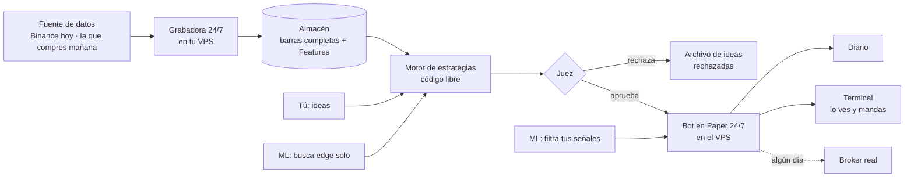
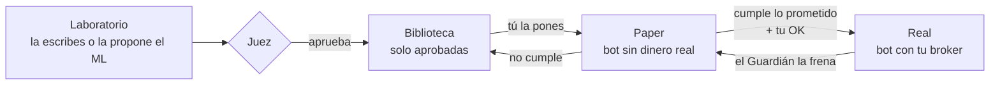

# Croquis de AthenAI (versión 2)

Borrador para revisar. No se toca código hasta que el usuario lo apruebe.
Fecha: 22-oct-2026.

## 1. La idea en una frase
Una plataforma donde **tú o la máquina proponen estrategias**, el **Juez** decide si hay edge de verdad o es suerte, y lo aprobado opera en **Paper** (y algún día en real). Todo sobre **tus propios datos**, que la grabadora junta 24/7.

## 2. Lo que se queda tal cual
Esto ya funciona y está probado; se lleva a la versión 2 sin reescribir sus cuentas.

| Pieza | Por qué se queda |
|---|---|
| **Grabadora 24/7 (VPS)** | Ya graba BTC y XAU. **La parte que graba no se toca.** Sus archivos son la base de todo |
| Motores de order flow | Absorción, icebergs, stop runs, OI, LHM…, con unas 300 pruebas |
| Juez | Walk-Forward, Monte Carlo, suerte, robustez, DSR, PBO y anti-futuro |
| Salidas | Stop, objetivo y gestión (fija, BE, escalonada); el mismo código en prueba y en vivo |
| Fichas de mercado | Contratos, valor del punto, tick |
| Diario | Ficha de cada operación y calendario día/semana/mes/año |

**Ojo:** la grabadora también sirve la página web y corre los bots. Esas dos partes **sí** se actualizan cuando llegue la versión nueva. Lo que graba y cómo lo guarda, no.

## 3. El dibujo general



- **En el VPS (24/7):** la grabadora, los bots y, más adelante, el entrenamiento del ML.
- **En el navegador:** solo ver y mandar. Si cierras la página, nada se detiene.

## 4. Motor de estrategias (lo más importante de la versión 2)
Hoy una estrategia solo ve el cierre y las Features, y solo dice comprado, vendido o fuera. En la versión 2 se escribe como en cualquier plataforma seria.

```python
# Ejemplo: rompe el máximo de 20 velas de 5 minutos con absorción a favor → compra con stop en el mínimo
def en_cada_vela(v, ctx):
    velas = ctx.velas('5m')                     # apertura, máximo, mínimo, cierre, volumen, delta
    maximo = max(x.high for x in velas[-21:-1])
    if not ctx.posicion and v.close > maximo and v.f['absorcion_bid'] > 60:
        ctx.comprar(stop=v.low, rr=2, gestion='be1R')
```

- **Lo que ve tu código:**
  - velas de 1m, 5m, 15m, 1h o dollar bars;
  - en cada vela: apertura, máximo, mínimo, cierre, volumen y delta;
  - todas las Features (absorción, icebergs, OI…) como extra.
- **Lo que puede hacer:**
  - comprar o vender a mercado, en límite o en stop;
  - poner stop, objetivo o RR;
  - mover el stop y salir.
- **Sin mirar al futuro:** el motor le entrega las velas **una por una**. Tu código no puede ver la siguiente.
- **El mismo código** corre en el Juez, en Paper y, algún día, en real.

## 5. Machine learning y red neuronal (se arma ahora, se entrena con meses de datos)

| Trabajo | Qué hace | Cuándo |
|---|---|---|
| **Filtro** | Aprende cuándo tomar cada señal de tu estrategia y cuándo no | Con una estrategia aprobada y 2–3 meses de datos |
| **Buscador de edge** | Prueba combinaciones solo y propone ideas | Con varios meses de datos o la fuente comprada |
| **Red neuronal** | Lo mismo con modelos profundos (CNN, LSTM, Transformer) | Después del ML clásico |

**Reglas fijas:**
1. **El Juez cuenta cada intento.** Si la máquina prueba 5.000 ideas, exige mucho más para aprobar una.
2. **La bóveda:** una parte de los datos se guarda aparte y la máquina nunca la ve. Una idea solo se cree si también funciona ahí.
3. **Nada pasa a Paper sin el Juez y sin tu OK.** Reentrenar cada semana, sí; cambiar de modelo solo, nunca.

## 6. Enchufes (nada depende de un proveedor)
- **Datos:** Binance hoy → la fuente que compres (Rithmic, Databento…) mañana. Se cambia el enchufe y nada más.
- **Historia de Bybit (gratis):** Bybit publica archivos con los trades uno por uno y el libro (L2) de sus contratos de cripto. Un **importador** los convierte al mismo formato de la grabadora, y así el Juez tiene **meses o años de BTC** para probar desde ya, sin esperar a que la grabadora junte datos.
  - **Ojo con oro, Nasdaq y S&P 500 en Bybit:** son contratos propios de Bybit (desde abril de 2026). El precio sigue al mercado real, pero el order flow es el de los clientes de Bybit, no el de la CME. Sirven para estrategias de precio; para order flow serio de esos mercados hace falta la CME (Rithmic). Lo mismo pasa con el oro de Binance que se graba hoy.
- **Órdenes:** Paper hoy → tu broker mañana. Los bots no saben dónde operan.
- **Tamaño:** en contratos o lotes según la ficha de cada mercado.

## 7. El camino de una estrategia (propuesta del usuario, 22-oct-2026)



- **Biblioteca:** solo estrategias aprobadas por el Juez, con su nota, su curva y en qué mercado se aprobó.
- **Paper:**
  - Cada bot tiene su propia cuenta dentro de AthenAI, para saber exacto cuánto gana cada uno.
  - Además, cada bot puede mandar sus órdenes a **una cuenta demo de un broker**, marcadas con su nombre, para comparar el precio de AthenAI con el llenado real del broker.
  - **Ojo:** en una sola cuenta, dos bots en el mismo mercado se pueden cancelar entre sí. Por eso la cuenta propia de cada bot manda.
  - Cada operación muestra por qué abrió, por qué cerró y si ganó o perdió, en R y en dinero.
- **Pasar a Real:** el bot necesita semanas de Paper haciendo lo que prometió el Juez, más tu OK. Real queda bloqueado hasta que haya broker conectado (decidir cuál al comprar la fuente de datos; MT5 solo corre bien en Windows).
- **Eventos fuertes (CPI, FOMC, nóminas):**
  - El calendario se llena solo, desde una fuente automática por definir.
  - Los bots **no operan** desde un rato antes hasta un rato después y muestran «esperando CPI».
  - No se intenta adivinar si el dato sale bueno o malo.

## 8. Pantallas propuestas (ajustadas con el usuario)

| # | Pantalla | Qué tiene |
|---|---|---|
| 1 | **Panel** | Resumen del día: mercados, bots, alertas. Cerebro 3D |
| 2 | **Laboratorio** | Editor de código libre y **el Juez completo, como está hoy**: Walk-Forward, Monte Carlo, prueba de suerte, robustez, DSR/PBO, anti-futuro y veredicto, con todas sus vistas. **Nada de eso se pierde**; solo se mejora el diseño (animaciones, 3D donde sume) |
| 3 | **Biblioteca** | Estrategias aprobadas por el Juez |
| 4 | **Paper** | Bots en prueba, cada uno con su porqué (cuenta propia + demo del broker) |
| 5 | **Real** | Bots que pasaron Paper (bloqueado hasta conectar broker) |
| 6 | **Terminal** | Lista tipo MetaTrader: posiciones, órdenes e historial de **todos** los bots (filtro Paper/Real); ticket a mano pequeño, a un lado |
| 7 | **Mercado** | Gráfico con DOM y los motores de order flow (eventos, memoria, Features, salud) |
| 8 | **Riesgo** | El Guardián: límites por bot y del día, apagado de emergencia, quién está frenado y por qué |
| 9 | **Diario** | Calendario, métricas y cada operación con su porqué |
| 10 | **Investigación** | **Red de hipótesis** (se queda siempre: cada estrategia probada es un puntito, aprobada o rechazada, y cómo se relacionan) + buscador de edge del ML + patrones |
| 11 | **Red neuronal** | Modelos profundos (cuando toque) |
| 12 | **Agentes** | Sala 3D: quién trabaja en qué |
| 13 | **Datos** | Fuentes, grabadora, almacén |
| 14 | **Calendario** | CPI, FOMC, nóminas… se llena solo; cuándo esperan los bots |
| 15 | **Sistema** | VPS, salud, notificaciones |

Por decidir más adelante (cuando se use y se vea si hace falta): separar Laboratorio en Editor + Juez, y Diario en Diario + Estadísticas.

Ninguna pantalla vacía «de adorno»: si no tiene motor, no aparece en el menú hasta que lo tenga. La red de hipótesis sí aparece desde el principio, porque se arma con las estrategias reales que pasan por el Juez.

## 9. Orden de construcción (unos 3 meses)
La plataforma actual sigue funcionando hasta que la nueva la reemplace. La grabadora graba todo el tiempo.

| Fase | Qué | Cómo se sabe que está lista |
|---|---|---|
| 0 | Este croquis | Lo apruebas |
| 1 | Esqueleto nuevo: menú, diseño, carga de datos grabados + **importador de la historia de Bybit (BTC)** | Abre rápido, lee tus datos del VPS y tiene meses de BTC importados |
| 2 | **Motor de estrategias + Juez** | Una estrategia de ejemplo pasa por el Juez de punta a punta |
| 3 | Biblioteca, Paper, Terminal (lista) y Diario | Un bot corre 24/7 en Paper con stop y objetivo, y se ve en la lista |
| 4 | Investigación y ML (armado, sin entrenar) | Con datos de prueba, el buscador propone y el Juez filtra |
| 5 | Visual: Panel 3D, Agentes, Red neuronal | Fotos aprobadas, sin lag en celular |

## 10. Reglas de trabajo
1. **Una pantalla a la vez**: fotos y tu OK antes de seguir.
2. **Sin lag:** cada pantalla se mide en un celular lento simulado; mínimo 30 cuadros por segundo.
3. **Sin código basura:** lo que se reemplaza se borra; nada de dos versiones de lo mismo.
4. **Solo datos reales** en la plataforma; los datos de prueba, solo para probar.
5. **Ideas nuevas** a `docs/PENDIENTES.md`, no directo al código.

## 11. Lo que tienes que decidir tú
1. ~~Pantallas~~ → propuesta del usuario anotada en las secciones 7 y 8. Falta: ¿qué broker para la cuenta demo? (se decide al comprar la fuente de datos)
2. ¿Dónde hacemos la versión 2? Mi recomendación: en este mismo repositorio, en una carpeta nueva. Así se reutilizan los motores sin copiarlos.
3. ¿Qué mercados además de BTC y XAU? (Más mercados = más datos para el ML, pero más disco en el VPS.)
4. ¿Qué te gusta del diseño actual y qué no? Si tienes fotos de plataformas que te gusten, mándamelas.
